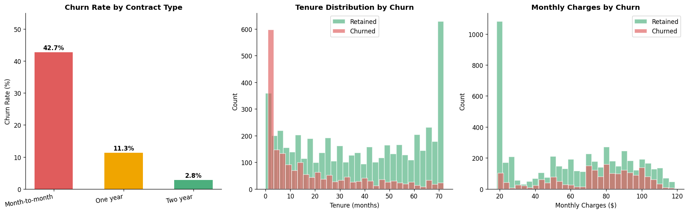
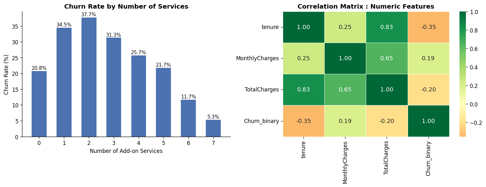
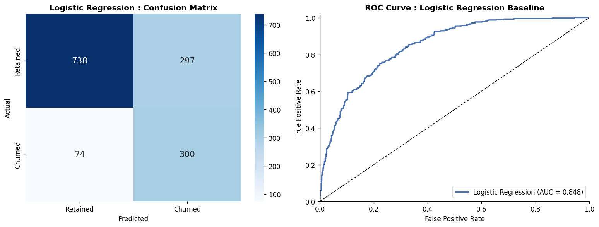
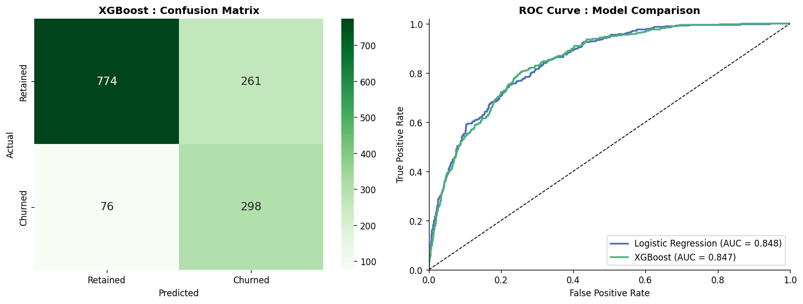
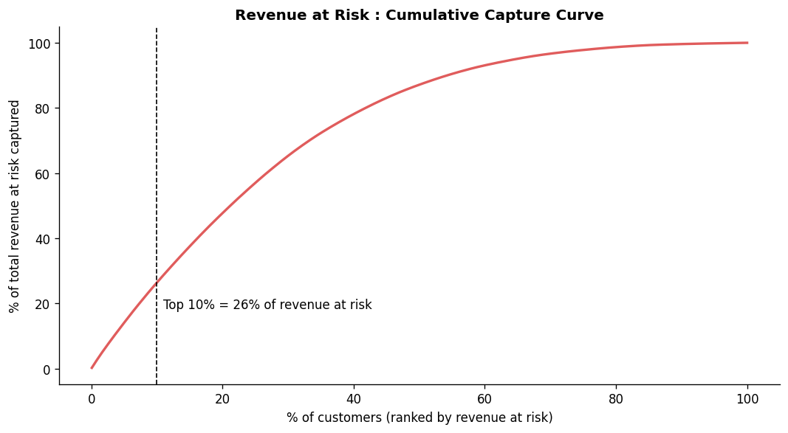
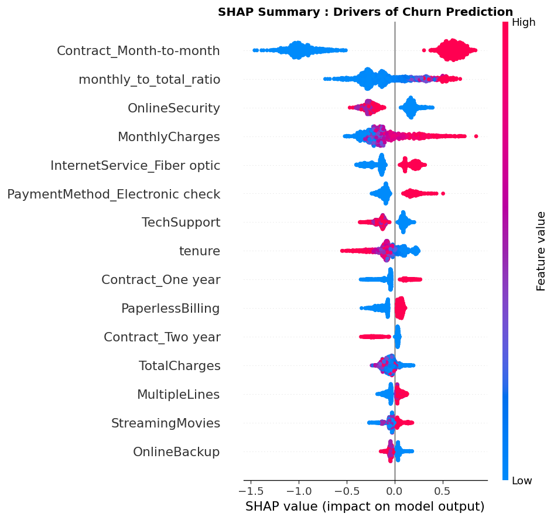

# Subscription Churn Predictor: Revenue-Weighted Retention Prioritisation

Predicts which telecom customers are likely to churn and ranks them by **revenue at risk** (churn probability × monthly charges), so a retention team knows who to contact first, not just who is likely to leave.

## Key results

| Model | AUC-ROC | Recall | Precision | F1 | Accuracy |
|---|---|---|---|---|---|
| Logistic Regression (baseline) | 0.848 | 0.802 | 0.503 | 0.618 | 0.737 |
| XGBoost (grid search, 5-fold CV) | 0.847 | 0.799 | 0.536 | 0.642 | 0.763 |

*Hold-out test set: 1,409 customers (20%), stratified split, `random_state=42`.*

- **A simple baseline is hard to beat on this dataset.** Tuned XGBoost and logistic regression reach the same AUC-ROC (0.85). XGBoost's advantage is higher precision (0.54 vs 0.50): it raises fewer false alarms at the same recall, which matters when each retention contact has a cost.
- **Revenue prioritisation works.** Ranking customers by revenue at risk, the top 10% (140 customers) holds **26% of the total revenue at risk**. Within this group the actual churn rate is **60.7%**, against 26.5% overall.
- **Month-to-month contracts are the dominant churn driver** (SHAP), followed by the share of lifetime spend that the current bill represents, monthly charges, lack of online security and fibre-optic internet.

## Data

[IBM Telco Customer Churn](https://www.kaggle.com/datasets/blastchar/telco-customer-churn): 7,043 customers, 20 features, 26.5% churn rate.

Blank `TotalCharges` values belong to 11 customers with zero tenure (new accounts with no completed billing cycle). They are set to 0, not dropped.

## Exploratory findings

| Contract | Churn rate |
|---|---|
| Month-to-month | 42.7% |
| One year | 11.3% |
| Two year | 2.8% |

- Customers in their first 12 months churn at 47.4%, against 9.5% for those with more than 4 years of tenure.
- Electronic-check payers churn at 45.3%, versus 15-19% for the other payment methods.
- Fibre-optic customers churn at 41.9%, versus 19.0% for DSL.




## Feature engineering

- `tenure_group`: tenure binned into five lifecycle stages (used for EDA, not as a model input).
- `num_services`: count of optional add-on services, a proxy for switching cost.
- `monthly_to_total_ratio`: current monthly bill divided by lifetime spend. A high value means a recent customer with little billing history, so lower inertia.

## Models

**Model 1: Logistic Regression (baseline).** Standardised features, `class_weight='balanced'`.



**Model 2: XGBoost with grid search.** `scale_pos_weight` (≈2.77) handles the 73/27 class imbalance. A grid of 36 combinations was searched with stratified 5-fold cross-validation on the training set, optimising AUC-ROC:

| Hyperparameter | Values searched |
|---|---|
| `learning_rate` | 0.01, 0.1, 0.3 |
| `max_depth` | 3, 5, 7 |
| `n_estimators` | 100, 300 |
| `subsample` | 0.8, 1.0 |

Best combination: `learning_rate=0.01`, `max_depth=5`, `n_estimators=300`, `subsample=0.8` (cross-validated AUC-ROC 0.848).



## Revenue at risk

```
revenue_at_risk = churn_probability × MonthlyCharges
```

A customer with an 80% churn probability paying 100 per month matters more than one with 90% probability paying 20. Customers are ranked by this score, and the top 10% form the intervention tier.

| | Value (test set) |
|---|---|
| Total monthly revenue at risk | 41,204 |
| Top 10% tier (140 customers) | 10,795 (26.2% of total) |
| Churn rate inside the top 10% tier | 60.7% (vs 26.5% overall) |
| Monthly revenue actually lost in the tier | 7,823 |



## Explainability (SHAP)

SHAP values show how much each feature pushed an individual prediction towards or away from churn. Top drivers by mean |SHAP|:

1. Month-to-month contract
2. `monthly_to_total_ratio`
3. Monthly charges
4. Online security (customers without it churn more)
5. Fibre-optic internet service



## Limitations

- The data is a single static snapshot, so the model predicts who *looks like* past churners, not why customers leave.
- The score uses monthly charges as a proxy for value. It ignores margins, customer lifetime value and the cost of the retention offer itself.
- Class weighting means the predicted probabilities are not calibrated. Treat `revenue_at_risk` as a **ranking score**, not a literal revenue forecast.
- Results come from one train/test split. Cross-validation was used only for tuning.

## How to run

```bash
git clone https://github.com/mlamaralp/subscription-churn-predictor.git
cd subscription-churn-predictor
pip install -r requirements.txt
```

The dataset is already included in `data/WA_Fn-UseC_-Telco-Customer-Churn.csv` ([original source on Kaggle](https://www.kaggle.com/datasets/blastchar/telco-customer-churn)), so the script runs right after installing the requirements:

```bash
python churn_analysis.py
```

The script prints all metrics and saves the charts to `images/`. Each chart window must be closed for the script to continue. Grid search runs 180 model fits, so allow a few minutes.

Requires Python 3.10+ with pandas, numpy, matplotlib, seaborn, scikit-learn, xgboost and shap. Results above were produced with xgboost 3.4.1, scikit-learn 1.9.1 and shap 0.53.0, and may vary slightly with other versions.

## Repository structure

```
├── churn_analysis.py      # full analysis: EDA, features, models, revenue at risk, SHAP
├── requirements.txt
├── data/                  # Telco churn dataset (CSV)
└── images/                # generated charts
```
